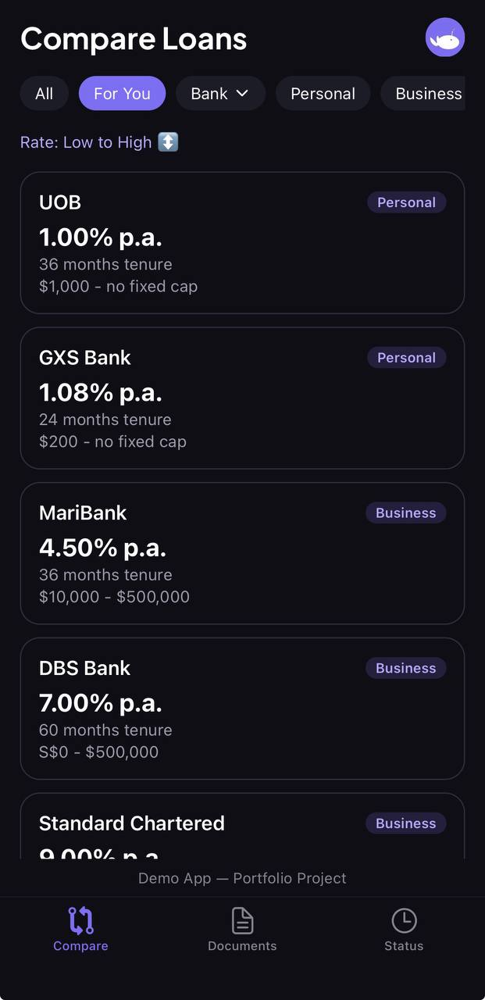
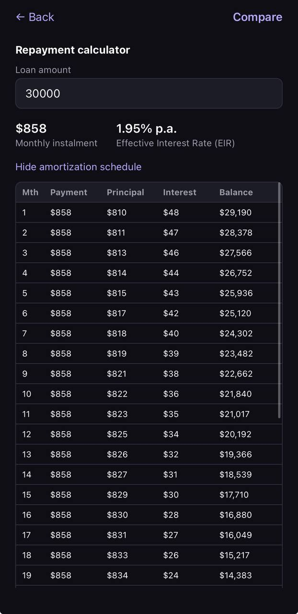
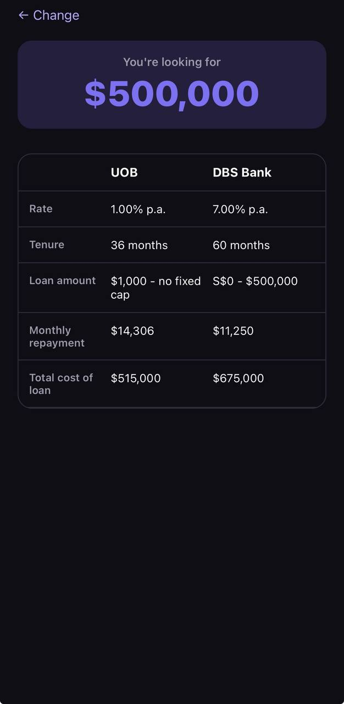
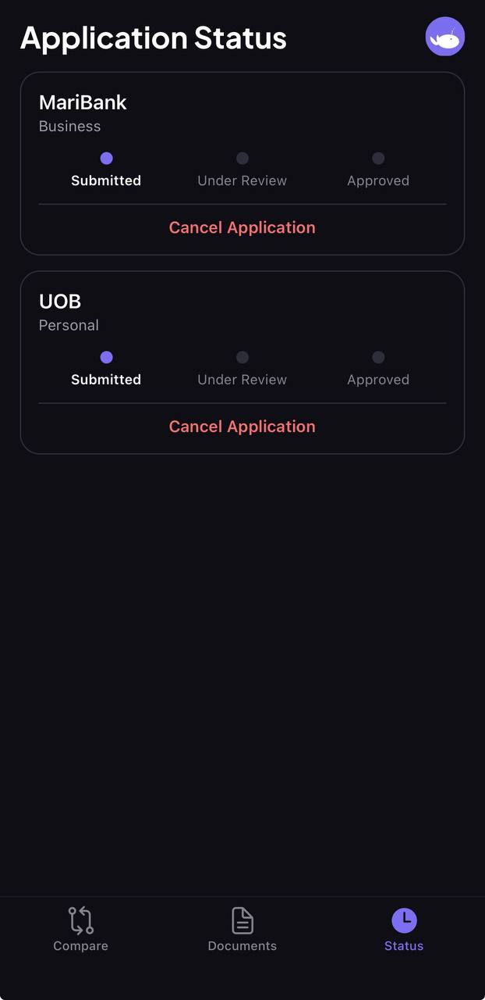
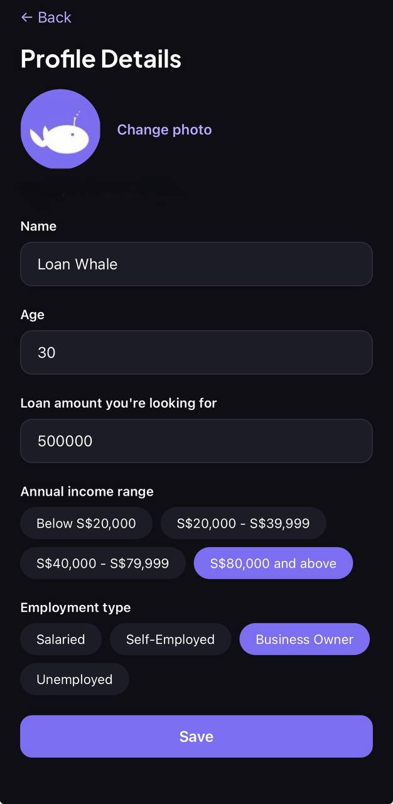

# LoanWhale 🐋

A loan comparison app for Singapore-based borrowers — browse real bank rates, calculate your true borrowing cost, and see only the loans you actually qualify for.

**This is a portfolio/demo project, not a real financial service.** No real user data is required beyond what's needed to demo the app, no real bank integrations, no real sales operations, and no real financial documents are ever stored — see [Demo constraints](#demo-constraints) below.

## Screenshots

| Compare ("For You") | Loan Detail + Calculator | Loan Comparison |
|---|---|---|
|  |  |  |

| Application Status | Profile Details |
|---|---|
|  |  |

## Features

- **Real Supabase Auth** — email/password sign-up and login
- **Loan comparison** — 13 real Singapore bank loan products (personal & business), filterable by type and bank, sortable by rate
- **"For You" matching** — filters to loans you're actually eligible for based on your age, income, and (for business loans) employment type
- **EIR & repayment calculator** — converts each bank's advertised flat rate into a real effective interest rate and full month-by-month amortization schedule, using the same reducing-balance method banks use internally (see [`src/lib/loan-math.ts`](src/lib/loan-math.ts))
- **Loan-vs-loan comparison** — pick any two loans and see rate, tenure, and loan amount side by side
- **Profile & document upload** — persistent profile (age, income, employment, avatar photo), plus a demo-safe document upload flow (see [Demo constraints](#demo-constraints))
- **Application tracking** — apply to a loan, track its status (Submitted → Under Review → Approved), cancel if you change your mind
- **Dark theme, onboarding flow, offline-friendly error handling**

## Tech stack

- **App**: React Native + [Expo](https://expo.dev) (SDK 54), [Expo Router](https://docs.expo.dev/router/introduction/) for file-based navigation
- **Backend**: [Supabase](https://supabase.com) — Postgres database, Auth, Storage, all secured with Row Level Security policies scoped per-user
- **Language**: TypeScript throughout, with types generated directly from the live database schema

## Demo constraints

This app deliberately does **not**:
- Store or process real financial documents — the Documents tab accepts a file selection and shows a "Received" confirmation, but the file itself is never uploaded or persisted anywhere
- Notify a real sales team — "application submitted" is a UI-only confirmation; nothing is emailed or sent to anyone
- Use a real backend for compliance/security infrastructure beyond Supabase's defaults

## Case study: a few product decisions worth explaining

**Why the EIR calculator computes the way it does.** Singapore banks advertise a "flat rate" (interest calculated once on the full principal, spread evenly across every instalment), but the loan is actually repaid on a reducing balance. The gap between the two is the Effective Interest Rate. Rather than hardcoding a rough multiplier, [`loan-math.ts`](src/lib/loan-math.ts) solves for the real reducing-balance rate via bisection — the same IRR-based method banks use — so the amortization schedule it produces is internally consistent (principal + interest always sums to the balance you'd expect, hitting exactly S$0 on the final month). It was cross-checked against the standard MAS rule-of-thumb approximation (`EIR ≈ flat rate × 2n/(n+1)`) and against the real published rates researched for the seed data.

**Why loan eligibility needed a schema change.** Each loan's requirements were originally just free-text ("Minimum annual income S$30,000…") — readable, but not something the "For You" filter could match against programmatically. Rather than trying to parse that text, I added structured `min_age`/`max_age`/`min_income_annual` columns derived from the same research, so the text stays human-readable while the filter has real data to check against. Business loans are handled differently: since the app doesn't collect any business-specific criteria (turnover, incorporation age, shareholding), they're only surfaced when employment type is "Business Owner" — an explicit, honest proxy rather than a false precision.

**A real RLS bug worth mentioning.** Avatar photo uploads initially failed with "new row violates row-level security policy" even though the insert policy was provably correct (verified via a direct SQL simulation). The actual cause: Postgres RLS requires a **SELECT** policy to cover a row for `INSERT ... RETURNING` to succeed, not just the INSERT policy — Supabase Storage's upload implementation uses `RETURNING` internally. Fixed by adding a SELECT policy scoped to each user's own folder (not a bucket-wide one, which a security advisor pass had already flagged as leaking filenames via listing).

## Getting started

```bash
git clone https://github.com/keithtay2190-ai/LoanWhale.git
cd LoanWhale
npm install
cp .env.example .env   # fill in your own Supabase project URL + anon key
npx expo start
```

Scan the QR code with the [Expo Go](https://expo.dev/go) app on your phone.

## Status

Feature-complete for demo purposes. Not yet on TestFlight — see the [build checklist](build-checklist.md) for what's left.
